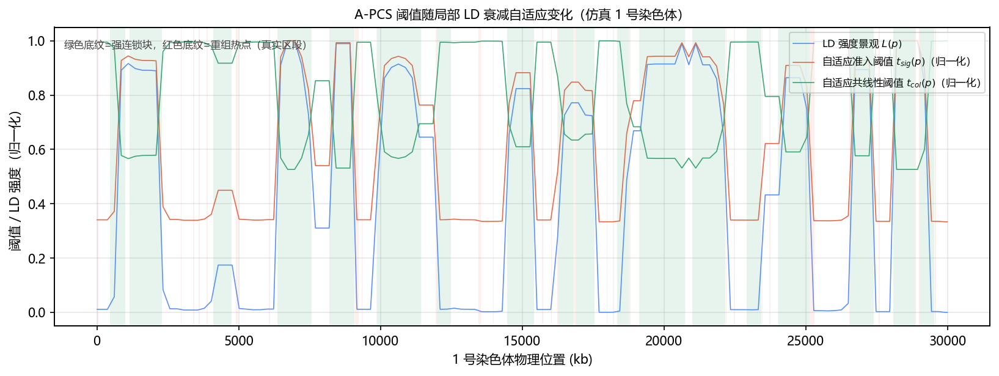
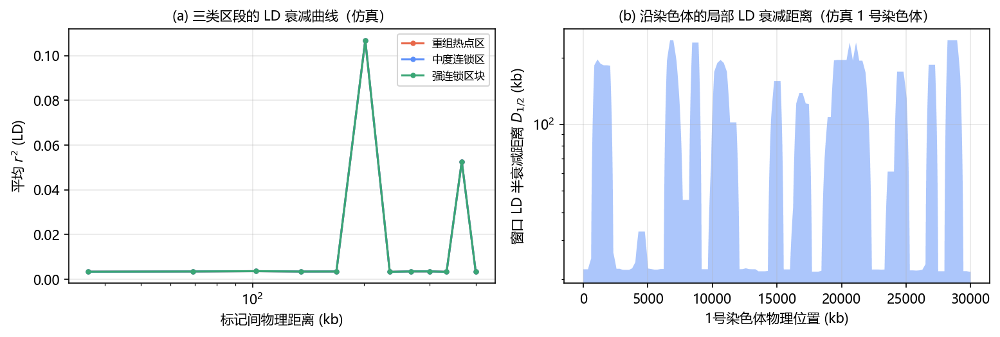
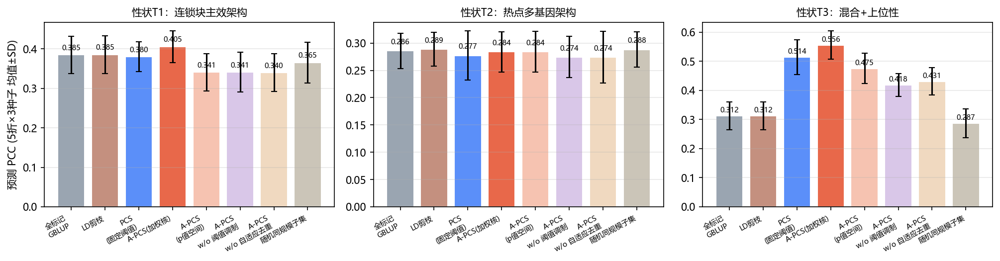
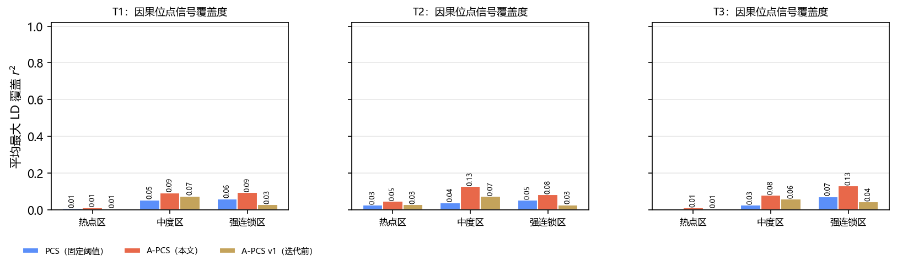
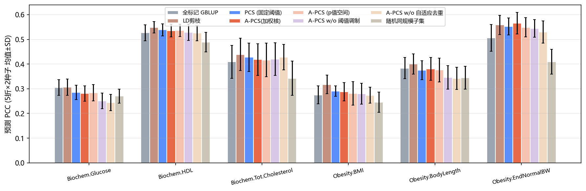
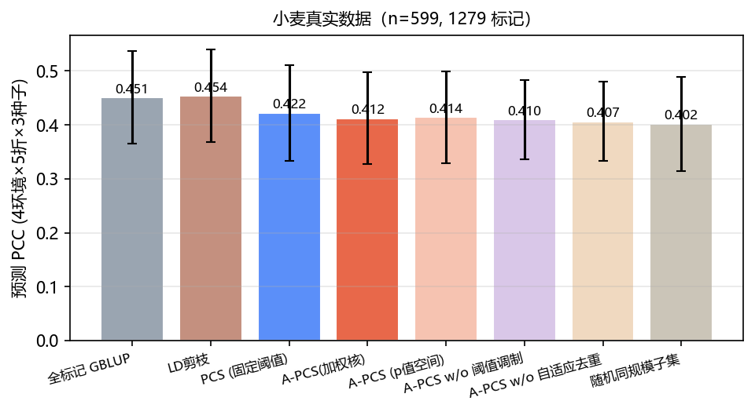
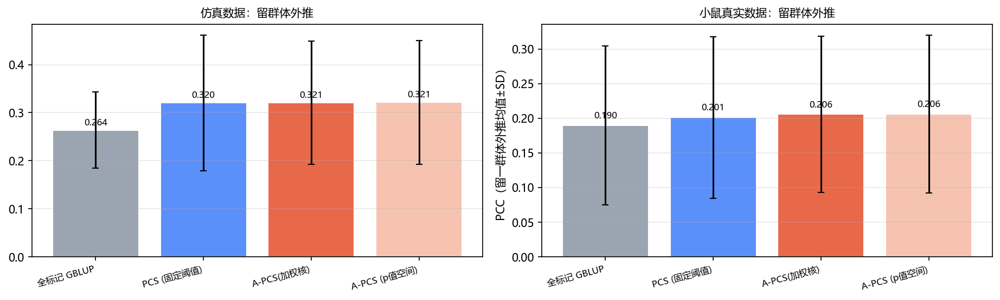
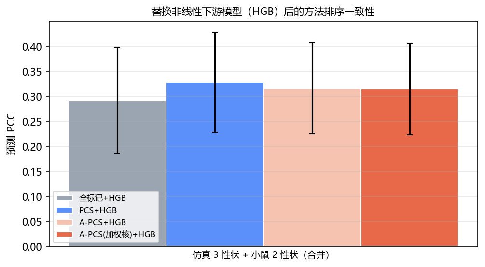

# A-PCS：自适应皮尔逊共线性筛选

**Adaptive Pearson Collinearity Screening** —— 一种面向全基因组预测的特征选择方法。它把"准入阈值"和"去重阈值"从一组固定数改成沿基因组连续变化的函数，让筛选规则跟着局部连锁不平衡（LD）的强弱走。方法推导、消融实验与失败分析见 [A-PCS 技术报告](A-PCS技术报告.pdf)。

## 1 项目背景

全基因组预测的典型场景是 p ≫ n：标记数远多于个体数，且标记之间高度共线。经典的两段式皮尔逊筛选（PCS）分两步——先按"标记—表型"相关筛掉弱关联位点，再按"标记—标记"相关剔除冗余位点。

问题出在阈值是全局固定的，而染色体的 LD 衰减速度沿基因组剧烈变化：

- **近着丝粒、低重组区**：LD 衰减慢，一个因果信号会复制出一大串高相关代理位点，固定阈值收不住，冗余大量留下；
- **重组热点区**：LD 衰减快，微效位点的边际相关天然很弱，固定阈值一刀切，真实信号被误删。

同一组阈值不可能同时适配这两种区段。A-PCS 的做法是先估计出"LD 强度景观"，再让两个阈值成为位置的函数。

## 2 方法原理

### 2.1 LD 强度景观 L(p)

按染色体切滑动窗口（物理宽度不超过 `W`，每窗至少 10 个标记），在窗口内计算平均 r² 随距离的衰减曲线，取 r² 首次降到首箱一半处的距离作为该窗口的 LD 半衰减距离 `d_half`。对所有窗口的 `d_half` 做 10%–90% 分位归一化后映射到 [0, 1]：

```
L = log(d_half / lo) / log(hi / lo)
```

再沿染色体中值平滑、插值到每个标记。`L(p) = 0` 是重组热点（快衰减），`L(p) = 1` 是强连锁块（慢衰减）。

### 2.2 自适应准入

对每个标记做与表型的相关 t 检验，准入水平随位置收紧：

```
q_eff(p) = q · (1 − b · L(p))
```

只有 `p ≤ q_eff(p)` 的标记进入候选：强 LD 区收紧，避免代理位点涌入；弱 LD 区放宽，保留微效位点。`b = 0` 时退化为固定阈值。准入放在 p 值空间而不是相关系数空间，使规则对样本量、标记密度和性状尺度近似不变，因而可以跨数据集迁移。

### 2.3 自适应去重

保留阈值在强、弱 LD 两端之间线性过渡，比较半径随局部半衰减距离放大：

```
t_col(p) = t_col_max − (t_col_max − t_col_min) · L(p)
d_nb(p)  = max(2 · d_half(p), W)
```

按 `|r(标记, 表型)|` 从大到小贪心扫描候选：若半径 `d_nb(p)` 内已有保留位点、且两者 `|r|` 达到 `t_col(p)`，则丢弃当前标记。

### 2.4 加权下游接口

可选用 `|PCC|^γ` 作为标记权重送入 GBLUP 等核方法，把筛选阶段的关联强度带进预测阶段：

```
K = (Z·√w)(Z·√w)ᵀ / Σw
```

`γ = 0` 时即等权。

### 2.5 主要参数

| 参数 | 含义 | 默认值 | 经验范围 |
| --- | --- | --- | --- |
| `W` | LD 景观窗口宽度（bp） | 150000 | 该物种 LD 半衰减距离的 2–3 倍 |
| `q` | 标记准入名义显著水平 | 0.10 | 0.05–0.30 |
| `b` | LD 对准入的调制深度 | 0.70 | 0.50–0.70 |
| `t_col_min` | 强 LD 区去重阈值 | 0.50 | 0.40–0.60 |
| `t_col_max` | 弱 LD 区去重阈值 | 0.90 | 0.85–0.95 |

## 3 环境配置

需要 Python 3.12。

```powershell
git clone https://github.com/chunlinsong42-web/A-PCS.git; cd A-PCS
python -m venv .venv
.venv\Scripts\Activate.ps1          # macOS/Linux 用 source .venv/bin/activate
pip install -r requirements.txt
```

## 4 快速开始

### 4.1 桌面版（无需 Python）

1. 下载发布页的 `A-PCS.zip` 并解压，进入 `A-PCS` 文件夹，双击 `A-PCS.exe`（`_internal` 必须和 exe 放在一起）。
2. 依次选择基因型、表型、位置三个文件，参数保持默认，点「开始分析」。
3. 输出目录下得到 `selected_markers.csv`、`ld_landscape.png`、`summary.txt`。

### 4.2 Python 接口

```python
import numpy as np
from apcs_core import qc_markers, standardize, ld_precompute, apcs2

X, y, pos, chrom = ...                      # 读取方式见 code/example_run.py
Xq, keep = qc_markers(X, maf_min=0.05, miss_max=0.2)
Z, _, _ = standardize(Xq)
yz = (y - y.mean()) / (y.std() + 1e-12)
pos, chrom = pos[keep], chrom[keep]

pre = ld_precompute(Z, pos, chrom, W=150_000)
kept, r = apcs2(Z, yz, pos, chrom, W=150_000,
                q=0.10, b=0.70, t_col_min=0.50, t_col_max=0.90, pre=pre)

print(f"{Z.shape[1]} -> {int(kept.sum())} markers")
```

## 5 示例数据

`data/sample/` 下是三个 CSV，格式与正式数据一致，可直接跑通全流程。

| 文件 | 列 | 说明 |
| --- | --- | --- |
| `matrix.csv` | `sample_id` + 每个标记一列 | 行 = 样本，列 = 标记，取值 0 / 1 / 2（纯合参考、杂合、纯合变异），缺失留空 |
| `phenotype.csv` | `sample_id`, `phenotype` | 连续性状数值，`sample_id` 与 `matrix.csv` 第一列一一对应 |
| `positions.csv` | `marker`, `chrom`, `pos` | 物理位置，单位 bp；`marker` 必须与 `matrix.csv` 表头完全一致 |

三个文件的规模必须对齐：样本数 = `matrix.csv` 行数 − 1 = `phenotype.csv` 行数 − 1；标记数 = `matrix.csv` 列数 − 1 = `positions.csv` 行数 − 1。

## 6 运行示例

```bash
python code/example_run.py
```

脚本读取 `data/sample/`，依次完成质控、LD 景观估计与自适应筛选，并在终端打印各阶段标记数和实际输出目录（默认 `results/example/`）。

本机实测：2000 个标记 → 质控后 1994 → 保留 78，压缩比 25.6×，核心计算约 0.2 秒；输出见 `results/example/`。

| 输出文件 | 内容 |
| --- | --- |
| `selected_markers.csv` | 保留标记的 `marker`、`chrom`、`pos`、与表型的相关系数绝对值、对应 p 值，按相关强度降序 |
| `ld_landscape.png` | 沿基因组的 LD 强度景观 `L(p)` 与两条自适应阈值曲线 |
| `summary.txt` | 本次参数、各阶段标记数、压缩比与耗时 |

## 7 实验结果

| 数据集 | 性状 | A-PCS `APCS2` | 全标记 `All` | 固定 PCS `PCS` |
| --- | --- | ---: | ---: | ---: |
| 仿真 | T1 块状寡基因 | 0.341 | **0.385** | 0.380 |
| 仿真 | T2 多基因 | 0.284 | **0.286** | 0.277 |
| 仿真 | T3 混合+上位 | 0.475 | 0.312 | **0.514** |
| 仿真 | 平均 | 0.367 | 0.327 | **0.390** |
| 小鼠 | 血糖 | 0.284 | **0.305** | 0.286 |
| 小鼠 | HDL | 0.536 | 0.527 | **0.539** |
| 小鼠 | 总胆固醇 | 0.417 | 0.409 | **0.428** |
| 小鼠 | BMI | 0.281 | 0.275 | **0.290** |
| 小鼠 | 体长 | 0.376 | **0.384** | 0.375 |
| 小鼠 | 末体重 | 0.548 | 0.506 | **0.553** |
| 小鼠 | 平均 | 0.407 | 0.401 | **0.412** |
| 小麦 | 环境 1 | 0.442 | **0.516** | 0.459 |
| 小麦 | 环境 2 | 0.440 | **0.456** | 0.441 |
| 小麦 | 环境 4 | 0.353 | **0.378** | 0.359 |
| 小麦 | 环境 5 | 0.422 | **0.454** | 0.429 |
| 小麦 | 平均 | 0.414 | **0.451** | 0.422 |

口径说明：这里是 v5 逐折均值，与上文报告正文引用的极值（+0.24、8–30× 等，取自特定性状/场景的最大值）

完整汇总（含 sd 与保留标记数）见 [results/summary_tables.md](results/summary_tables.md)，机器可读版见 [results/summary_metrics.csv](results/summary_metrics.csv)。


*仿真 1 号染色体：`L(p)` 与准入、去重两条阈值曲线随位置联动；底纹为模拟器真值区段（绿＝强连锁块，红＝重组热点）。*


*热点区、中度区、强连锁区的平均 r² 随物理距离衰减。*


*三种遗传架构下的预测 PCC（5 折 × 3 种子）。*


*按热点区、中度区、强连锁区分别统计的信号覆盖度。*



*真实数据各性状的预测 PCC（上：小鼠，下：小麦）。*



*稳健性检验：留群体外推（上）、非线性下游 HGB（下）。*

## 8 目录结构

```
A-PCS/
├── README.md / LICENSE / requirements.txt / A-PCS技术报告.pdf
├── data/sample/            # matrix.csv、phenotype.csv、positions.csv
├── code/
│   ├── apcs_core.py        # 核心实现：质控、LD 景观、A-PCS、基线
│   ├── example_run.py      # 最小可运行示例
│   ├── simulate.py         # LD 异质性仿真器
│   ├── experiments.py      # 无泄漏交叉验证框架
│   ├── run_sim.py          # 仿真实验
│   ├── run_mice.py         # 小鼠数据
│   ├── run_wheat.py        # 小麦数据
│   ├── run_loco.py / run_hgb.py / run_transfer.py   # 外推、换模型、阈值迁移
│   ├── diagnostics.py / gamma_sweep.py             # 覆盖度诊断、γ 扫描
│   ├── make_figures.py     # 图表
│   └── fill_report.py      # 报告数字注入
├── figures/                # 报告插图
└── results/                # 逐折结果与诊断
```

## 9 适用边界

- **对纯上位性位点不敏感**：没有主效应的信号只能通过边缘化效应被间接保留。
- **依赖可靠的物理位置或标记顺序**：没有图谱时需用伪距离近似，结果只能作参考。
- **`q` 未做有效检验数校正**：块内代表唯一性承担了部分多重性控制，而非严格的 FDR。
- **参数整定以 GBLUP 为下游目标**：换成强非线性模型时，最优 `q` 可能比默认值更宽松。

## 10 LICENSE

本项目采用 [MIT License](LICENSE)。

## 11 引用

```bibtex
@misc{apcs2026,
  title        = {A-PCS: Adaptive Pearson Collinearity Screening},
  author       = {Song, Chunlin},
  year         = {2026},
  howpublished = {\url{https://github.com/chunlinsong42-web/A-PCS}}
}
```
